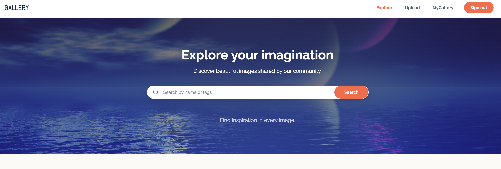
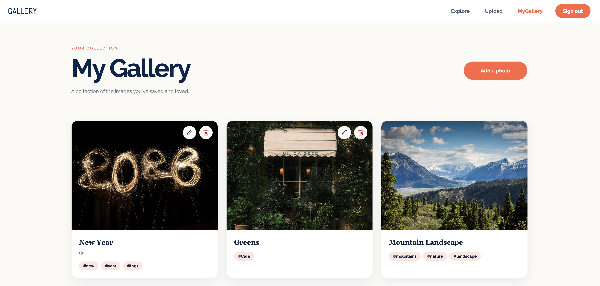

# Gallery

A modern image collection app built with **React, TypeScript, and Supabase**.

Gallery lets users explore, search, and publish images through a responsive interface. It combines a clean frontend experience with authentication, cloud storage, and database integration.

**[Live Demo](https://gallery-39ds.vercel.app/)** 

---

## Built With

- **Frontend:** React, TypeScript, React Router
- **Styling:** SCSS Modules
- **Backend:** Supabase
- **Database:** PostgreSQL
- **Authentication:** Supabase Auth
- **File Storage:** Supabase Storage

---

## Preview

### Explore Gallery

Browse images and search by name or tags.



### Upload Images

Publish images using a file upload or a direct image URL, with validation and image previews.


### My Gallery

View uploaded images in a dedicated gallery interface.



---

## What Gallery Demonstrates

### Frontend Engineering

- Building reusable, typed React components
- Managing forms, validation, and asynchronous UI states
- Implementing client-side routing and protected pages
- Creating responsive layouts with SCSS Modules
- Providing image previews, loading feedback, and error handling

### Backend & Data Integration

- Integrating Supabase Auth for user authentication
- Using PostgreSQL to store and retrieve image metadata
- Uploading image files to Supabase Storage
- Implementing Row-Level Security policies
- Handling failures across storage and database operations

### Product Functionality

- Browse and search images
- Sign up and sign in
- Upload images from a device
- Publish images using direct URLs
- Validate JPEG, PNG, and WebP uploads up to 5 MB
- Add image names and tags
- View published images in a gallery

---

## How It Works

Gallery uses Supabase for authentication, image storage, and database operations.

1. A user signs in through Supabase Auth.
2. The user selects an image file or enters a direct image URL.
3. The application validates the image.
4. Uploaded files are stored in Supabase Storage.
5. Image metadata is saved in PostgreSQL.
6. The gallery retrieves and displays the published images.

Storage and database access are controlled using Supabase Row-Level Security policies.

---

## Getting Started

### Prerequisites

- Node.js
- Yarn
- A Supabase project

### Installation

Clone the repository:

```bash
git clone YOUR_REPOSITORY_URL
cd gallery
```

Install dependencies:

```bash
yarn install
```

Create a `.env` file in the project root:

```env
REACT_APP_SUPABASE_URL=your_supabase_project_url
REACT_APP_SUPABASE_ANON_KEY=your_supabase_publishable_key
```

Configure your Supabase project with the required `gallery` table, authentication settings, `gallery-images` Storage bucket, and access policies.

Start the development server:

```bash
yarn start
```

Open [http://localhost:3000](http://localhost:3000).

> Never expose Supabase secret or service-role keys in frontend environment variables.

---

## What's Next

I'm exploring ways to extend Gallery with practical AI capabilities:

- **AI-generated captions:** Suggest descriptive captions from uploaded images.
- **Automatic tagging:** Identify relevant keywords using image analysis.
- **Semantic search:** Find images through natural-language descriptions.
- **Image optimization:** Resize and compress large uploads.

These features are planned improvements, not part of the current release.

---

